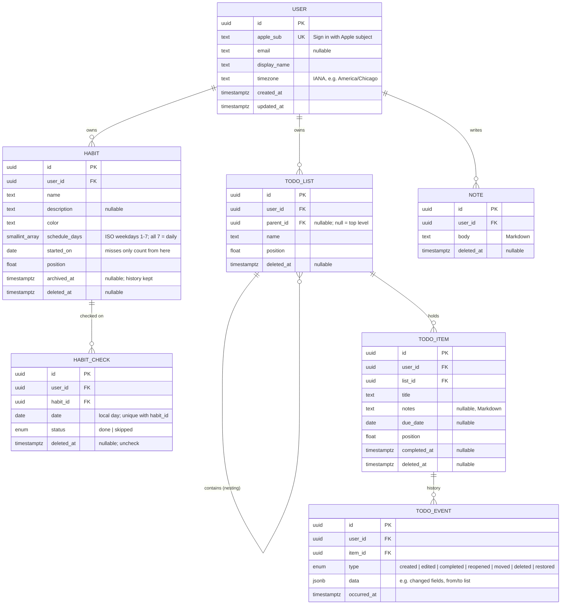

# Architecture

OnTheRecord's design decisions. Set by ROADMAP F1.2 (product & data design) and kept current as features land.

## Overview
A personal life-management app with three modules:
- **Habits**: a daily check per habit, streaks, and a GitHub-style contribution heatmap.
- **Todos**: nested lists of checkable items. Replaces Apple Reminders and keeps the full completion history.
- **Notes**: quick Markdown capture through the day. Later synced to an Obsidian vault, where an agent files and tags notes.

One backend, two clients:
- **Backend** (`backend/`): Python 3.13, FastAPI, PostgreSQL. The only holder of data.
- **iOS** (`ios/`): SwiftUI. The primary client (~95% of use): quick checks, todos, capture.
- **Web** (`web/`): React + TypeScript. Analytics, charts, history, and richer views.

Single user (the owner) for now, built so it can open to friends or the public later.

## Decisions at a glance
| # | Decision | Why |
|---|---|---|
| D1 | **v1 = habits, todos, notes**, online, one user | The smallest version the owner will use daily. Everything else goes to the Phase 5 backlog. |
| D2 | **Every row carries `user_id`** from day one, and every query is scoped by it | Multi-user later costs nothing now. Retrofitting tenancy onto live data is a painful migration. |
| D3 | **FastAPI** for HTTP | Pydantic types fit mypy strict. It generates an OpenAPI spec automatically, which drives both clients (D12). |
| D4 | **PostgreSQL 18** | Multi-user, the production standard, and strong date functions for streaks and heatmaps. Native `uuidv7()`. Offered as a managed service by every host. Local dev runs Postgres in Docker. Tests run against real Postgres, not SQLite. |
| D5 | **SQLAlchemy 2.0 (typed, sync sessions) + Alembic**, driver **psycopg 3** | The standard Python ORM and migration pair. Sync sessions are simpler than async. FastAPI runs sync endpoints in a thread pool, which is plenty at this scale. |
| D6 | **UUID primary keys.** Clients may supply an id; otherwise the server generates UUIDv7 | Clients can create records before the server replies, which enables optimistic UI now and offline sync later. v7 ids sort by creation time, which keeps indexes efficient. |
| D7 | **Sync-ready, but online-only in v1**: `created_at`, `updated_at`, `deleted_at` (soft delete) on every mutable table | Full offline sync is a hard problem and is deferred. These columns are all it will need, so adding it later won't require a redesign. |
| D8 | **Habit checks are local calendar dates.** "Missed" is derived, not stored. A `skipped` status protects streaks | A check answers "did I do it that day?" in the owner's local day, so it can't drift across timezones. A miss = a scheduled day with no check. |
| D9 | **Todo history = append-only `todo_events`**, written in the same transaction as the item change | Apple Reminders keeps only the current state. An event log keeps everything and feeds web analytics and the future Obsidian agent. |
| D10 | **Notes stored as Markdown** | Maps 1:1 to Obsidian files later. |
| D11 | **Auth: Sign in with Apple**, then server-issued tokens: a 15-minute JWT access token and a rotating, hashed refresh token ([Auth rules](#auth-rules-f25)) | iPhone-first, and it works on web too. Our own tokens mean Apple is contacted only at sign-in, and sessions can be revoked per device. |
| D12 | **The OpenAPI spec is the API contract.** Clients are generated from it: Swift (`swift-openapi-generator`) and TypeScript (`openapi-typescript` + `openapi-fetch`) | One source of truth. A backend change that breaks a client fails type-checking, not at runtime. |
| D13 | **Security: TLS in transit + the host's encryption at rest. No end-to-end encryption.** Secrets only in env vars | With E2E, the server couldn't read the data, which would rule out server-side analytics and the notes agent. Can be revisited for specific fields later. |
| D14 | **Phase order: Backend → iOS → Web** | The phone is the daily driver. The API is still designed for web analytics from the start (aggregate endpoints, D9 events). |
| D15 | **Hosting: decided in F2.6**, before the first deploy. Plan: Railway, with a dedicated Postgres 18 for OnTheRecord and least-privilege roles ([HOSTING.md](HOSTING.md)) | The phone needs a reachable server. No reason to lock in a host before there is something to deploy. A dedicated database keeps sensitive data isolated from other apps. |

## Data model



`created_at` and `updated_at` exist on every table but are left out of the diagram for brevity.

Rules:
- **All timestamps are `timestamptz`, stored in UTC.** Habit check dates are plain `date` values in the owner's local day (D8). `user.timezone` lets the server know what "today" means for streaks.
- **Missed day** = a date on or after `started_on`, whose weekday is in `schedule_days`, with no live check. In v1, editing a schedule re-evaluates past days. Versioned schedules can come later if that ever matters.
- **Uncheck** soft-deletes the check. Re-checking the same day upserts on `(habit_id, date)` and clears `deleted_at`.
- **Ordering** uses a float `position`. To insert between two rows, use the midpoint of their positions. Renumber the rows if the gaps get too small.
- **Nesting**: a list can contain lists and items, so lists also act as folders. The service layer rejects moves that would create a cycle. Deleting a list soft-deletes its subtree.
- **Todo events** are only ever inserted, never updated or deleted. Every item mutation goes through a service function that writes the event in the same transaction.

## API
REST + JSON under `/api/v1`. The spec is generated by FastAPI at `/openapi.json` (D12). Lists that grow (notes, events) use cursor pagination.

| Area | Endpoints |
|---|---|
| Health | `GET /health` |
| Auth (F2.5) | `POST /auth/apple` (Apple identity token + raw nonce → access + refresh), `POST /auth/refresh` (rotates), `POST /auth/logout`, `POST /auth/dev` (dev/test only), `GET /me`, `PATCH /me` (display name, timezone) |
| Habits | `GET /habits?for_date=YYYY-MM-DD&include_archived=` (adds that day's check status: the iOS "today" view), `POST /habits`, `GET/PATCH/DELETE /habits/{id}` (archive = `PATCH archived: true`) |
| Habit checks | `PUT /habits/{id}/checks/{day}` (body: `status`; idempotent), `DELETE /habits/{id}/checks/{day}`, `GET /habits/{id}/checks?from=&to=` |
| Habit analytics | `GET /habits/{id}/stats` (current/longest streak, completion rate), `GET /habits/heatmap?from=&to=&habit_id=` (per day: scheduled, done, skipped) |
| Todo lists | `GET /lists` (flat, with `parent_id`; the client builds the tree), `POST /lists`, `PATCH /lists/{id}` (rename, move, reorder), `DELETE /lists/{id}` |
| Todo items | `GET /lists/{id}/items?completed=`, `POST /lists/{id}/items`, `PATCH /items/{id}` (edit, move, reorder, `completed: true/false`), `DELETE /items/{id}` |
| Todo history | `GET /items/{id}/events`, `GET /todo-events?from=&to=` (analytics) |
| Notes | `GET /notes?q=&cursor=` (newest first, full-text search), `POST /notes`, `GET/PATCH/DELETE /notes/{id}` |

## Habit rules (F2.2)
Implemented in `services/habit_stats.py` (pure functions, unit-tested on fixed dates) and `services/habits.py`.
- **Expected day**: on or after `started_on`, before the day the habit was archived, and its ISO weekday is in `schedule_days`.
- **Streak**: `done` extends it, even on an unscheduled day (a bonus). `skipped` neither counts nor breaks it. An expected day with no check is a miss and resets it. **Today is pending**, so an unchecked today never breaks a streak.
- **Completion rate** = done on expected days ÷ (done on expected days + misses). Skips and today-pending are excluded; `null` until a day is decided.
- **Check writes**: no future days (by the user's timezone), none before `started_on`, none on archived habits (409). `PUT` upserts on `(habit_id, date)` and revives an unchecked row; `DELETE` soft-deletes; both are idempotent.
- **Heatmap** returns per day `scheduled` / `done` / `skipped` counts. Clients map done ÷ scheduled to `heat-0`…`heat-4` and skips to `heat-skip` (design system). The range defaults to the last 365 days, capped at 731.
- **Colours** are stored as the design system's names (`green`, `blue`, `orange`, `plum`, `gold`, `slate`), never hex: the client resolves them per theme.
- **Enums** (`color`, `status`) are `varchar` + `CHECK`, not native Postgres enums, so adding a value is a simple migration.
- **Errors**: services raise `NotFoundError` / `ConflictError` / `InvalidInputError` (`services/errors.py`); `main.py` maps them to 404 / 409 / 422 with FastAPI's `{"detail": …}` shape. Another user's row is a 404, indistinguishable from a missing one.

## Todo rules (F2.3)
Implemented in `services/todos.py`.
- **Tree**: `GET /lists` is flat with `parent_id`, plus each list's `open_count`; clients build the tree. New lists and items go to the end of their siblings unless a `position` is given.
- **Cycle-safe moves**: moving a list walks up from the new parent with a recursive CTE (a query that repeats on its own results); meeting the moved list means a loop → 409. Moving into an unknown list, or another user's, is a 404.
- **Subtree delete**: deleting a list soft-deletes every sublist below it and all their items. Each item gets a `deleted` event with `{"via_list_id": …}`.
- **Events (D9)**: every item change writes its event in the same transaction. One PATCH can write several, in order `edited` → `moved` → `completed`/`reopened`. `edited` stores only fields that really changed (`{"changes": {field: {"from", "to"}}}`); a no-op PATCH writes nothing. **A pure reorder writes no event**: it's layout, not history. `restored` is reserved for a future undo.
- **Append-only, enforced twice**: by the service (insert only) and by a Postgres trigger that rejects any `UPDATE` on `todo_events` (migration `0003`). Deletes still cascade with their item or user.
- **History stays readable**: `GET /items/{id}/events` works for deleted items.
- **Pagination**: `GET /todo-events` is ordered by id. UUIDv7 ids sort by creation time, so id order is chronological and the last id is the cursor (`after`). `from`/`to` are local days in the user's timezone. Default 100 per page, max 500.
- **Ordering**: open items by `position`; with `completed=true`, newest completed first.

## Note rules (F2.4)
Implemented in `services/notes.py`.
- **Body** is Markdown, stored exactly as sent (no trimming; whitespace matters in Markdown). Blank bodies are rejected; max 100,000 characters.
- **Full-text search**: `notes.search` is a generated `tsvector` column (`to_tsvector('english', body)`), so Postgres keeps it current on every insert and update, with a GIN index. `q` is parsed by `websearch_to_tsquery`: plain words (stemmed: "run" finds "running"; all must match), `"quoted phrases"`, `or`, `-excluded`. Results stay newest first, not ranked, so pagination works the same with or without `q`.
- **Keyset pagination**: `GET /notes` orders by `(created_at, id)` descending, and the cursor encodes the last row's pair (base64 JSON, opaque to clients). The next page is `WHERE (created_at, id) < cursor`: fast on any page, and new notes never shift or repeat later pages. `id` breaks ties and works even for client-supplied ids that aren't time-ordered. Malformed cursors → 422. Default 50 per page, max 100.

## Auth rules (F2.5)
Implemented in `services/apple.py`, `services/auth.py` and `api/deps.py`. Every route except `/health` and `/auth/*` needs `Authorization: Bearer <access token>`.
- **Apple identity token** (a JWT the app gets from Apple): verified for an RS256 signature by one of Apple's published keys (fetched from `appleid.apple.com/auth/keys`, cached an hour, refetched on an unknown `kid`), `iss` = Apple, `aud` in `OTR_APPLE_CLIENT_IDS` (iOS bundle id, later the web Services ID), not expired, and `nonce` = SHA-256 hex of the raw nonce the app sends alongside (stops replaying a captured token). No client ids configured → every Apple sign-in is refused; prod won't start without them.
- **Users** are found or created by Apple's `sub`. Apple sends the name only on the first sign-in, so `display_name` is used only on creation; the email is updated when Apple sends one.
- **Access token**: JWT, HS256 with `OTR_JWT_SECRET` (≥ 32 chars), 15 minutes, claims `iss=ontherecord`, `sub=<user id>`, `typ=access`. The algorithm is pinned on decode (`alg=none` and forged tokens fail). Stateless, so it can't be revoked early; the short life bounds that. A token for a deleted user is a 401.
- **Refresh token**: 256 random bits, 60 days, stored only as a SHA-256 hash (a DB leak can't be replayed; high-entropy tokens don't need bcrypt). **Single use**: each refresh marks the row used and issues a new one in the same *family* (one family = one signed-in device). **Reuse detection**: presenting a used token means a copy exists, so the whole family is revoked. The row is locked (`FOR UPDATE`) during a refresh, so clients must not refresh twice in parallel with one token.
- **Logout** revokes the token's family. Unknown tokens are ignored, so it's idempotent and leaks nothing.
- **Errors**: services raise `UnauthorizedError` → 401 with `WWW-Authenticate: Bearer` and a deliberately vague detail.
- **Dev sign-in**: `POST /auth/dev` returns tokens for the local dev user. The router is only mounted when `OTR_ENV` isn't `prod`, so it doesn't exist (or appear in the spec) in production. `/docs` has an Authorize button for the access token.
- **Sign-ups are open** to anyone who can get an identity token for our app ids (only our own app can). Every row is scoped to its user. An allow-list can be added before a public launch.

## Backend layout (F2.1)
```
backend/
  compose.yaml          local Postgres 18 (Docker); values from backend/.env
  .env.example          OTR_* settings + POSTGRES_* for compose
  alembic.ini, migrations/   Alembic; sequential revision ids (0001, 0002, …)
  src/ontherecord/
    main.py             create_app(settings) factory; `run()` = dev server
    config.py           Settings (pydantic-settings, OTR_ env prefix)
    db.py               engine, session factory, get_session dependency
    models/             SQLAlchemy models; base.py = Base, UUIDPrimaryKey, Timestamps
    schemas/            Pydantic request/response models
    services/           business rules (routes call these)
    api/                routers under /api/v1; deps.py = SessionDep, CurrentUser (bearer auth)
  tests/                conftest.py: real Postgres, migrated once, rollback per test
```
Conventions set in F2.1:
- **App factory**: `create_app(settings)` builds the engine and stores it on `app.state`, so tests can build an app against any database without global state.
- **Sessions**: one per request (`SessionDep`). Routes/services call `session.commit()` explicitly; anything uncommitted rolls back on close.
- **Constraint names** follow a naming convention (`pk_users`, `uq_users_apple_sub`, `fk_<table>_<col>_<ref>`) so later migrations can alter them reliably.
- **Ids** default to `uuidv7()` in the database (D6), so rows inserted by any path get one.
- **Auth**: `CurrentUser` resolves the bearer access token (F2.1 shipped a dev stub; replaced in F2.5, see Auth rules). Tests sign in with real tokens.
- **Tests**: the session-scoped fixture runs `alembic downgrade base` + `upgrade head`, so every migration's up and down path runs on every test run. Each test uses a SAVEPOINT-joined session in an outer transaction that is rolled back.

## Later (not in v1)
Obsidian sync and the notes agent, offline sync, reminders and notifications, recurring todos, tags, numeric and "N× per week" habits, sharing, public sign-up. See ROADMAP Phase 5.

## Design
- **Design system:** [OnTheRecord](https://claude.ai/artifact/Y9zVdSXCJazXweNe3JHdHi) (Claude Design, F1.3). The truth for look and components. Direction: **calm native**. iOS-feeling, system fonts (SF Pro / SF Mono), warm-grey neutrals, one green `accent`, and the habit heatmap as the signature element. Light and dark.
  - Tokens: colour (ground, ink, accent, `heat-0`…`heat-4` + `heat-skip`, `warning`, `danger`, six `habit-*` colours), type styles mirroring iOS text styles, 4-pt spacing, radii by role, `shadow-float`, sizes (44 tap target, 28 check, 12 heatmap cell).
  - Components: HabitRow, Heatmap, TodoRow (+ cover).
  - Rules worth remembering: a missed day is never red; `danger` is only for destructive actions; habit colours never carry meaning without the name.
  - Using it: web maps tokens to CSS variables + Tailwind `@theme` (F4.1); iOS maps colours to asset-catalog Color Sets and type to `Font.TextStyle` (F3.1).
- Canvases: none yet. The first screens (iOS Today, todos, notes) are designed in F3.1.
